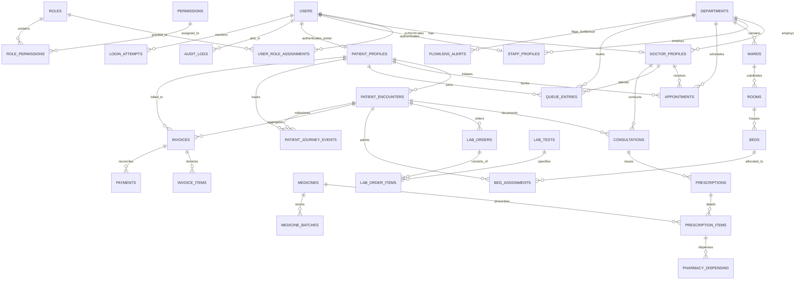

# KVM Hospital Management System — NexusCare
## Entity-Relationship (ER) Diagram & Relational Modeling

This document illustrates the relational schema, foreign key dependencies, and cardinality across all departments of **NexusCare**.

---

### High-Level System Architecture & ER Diagram

---

### Core Relationship Specifications & Cardinality

| Parent Entity | Child Entity | Foreign Key Column | Cardinality | Business Rule Enforced |
|---|---|---|---|---|
| `users` | `user_role_assignments` | `user_id` | 1 : N | Users can have multiple authorized roles (e.g. Doctor + Dept Head). |
| `roles` | `user_role_assignments` | `role_id` | 1 : N | Standard roles mapped to users. |
| `roles` | `role_permissions` | `role_id` | 1 : N | Fine-grained capability assignment. |
| `departments` | `doctor_profiles` | `department_id` | 1 : N | Doctors belong to a clinical department. |
| `departments` | `wards` | `department_id` | 1 : N | Inpatient wards assigned to clinical divisions. |
| `wards` | `rooms` | `ward_id` | 1 : N | Wards contain individual patient rooms. |
| `rooms` | `beds` | `room_id` | 1 : N | Rooms contain physical numbered beds. |
| `beds` | `bed_assignments` | `bed_id` | 1 : N (Historical) | Historical ledger. Application and DB enforce exactly 1 active assignment per bed at any instant. |
| `patient_profiles` | `patient_encounters` | `patient_id` | 1 : N | Longitudinal clinical container for episodes of care. |
| `patient_encounters` | `consultations` | `encounter_id` | 1 : N | Consultations linked to specific encounter. |
| `consultations` | `prescriptions` | `consultation_id` | 1 : 1 or 1 : N | Prescriptions authored by doctor during visit. |
| `prescriptions` | `prescription_items` | `prescription_id` | 1 : N | Prescriptions contain multiple medicines. |
| `medicines` | `prescription_items` | `medicine_id` | 1 : N | Drug catalog reference. |
| `medicines` | `medicine_batches` | `medicine_id` | 1 : N | Lot number and expiry date tracking. |
| `patient_encounters` | `lab_orders` | `encounter_id` | 1 : N | Laboratory orders ordered per encounter. |
| `lab_orders` | `lab_order_items` | `lab_order_id` | 1 : N | Multi-test requisitions. |
| `lab_tests` | `lab_order_items` | `test_id` | 1 : N | Lab catalog reference. |
| `patient_profiles` | `queue_entries` | `patient_id` | 1 : N | Patient outpatient waiting list. |
| `doctor_profiles` | `queue_entries` | `doctor_id` | 1 : N | Live token sequence per doctor. |
| `patient_profiles` | `patient_journey_events` | `patient_id` | 1 : N | Unified CareTrail timeline stream. |
| `patient_encounters` | `invoices` | `encounter_id` | 1 : 1 or 1 : N | Inpatient/outpatient financial consolidation. |
| `invoices` | `invoice_items` | `invoice_id` | 1 : N | Consultation, pharmacy, lab, bed line items. |
| `invoices` | `payments` | `invoice_id` | 1 : N | Partial and full payment receipts. |
| `users` | `audit_logs` | `user_id` | 1 : N | Compliance trail tracking every mutation. |

---

### Integrity Controls & Constraints

1. **Foreign Key Deletion Safety:**
   - Critical medical records (`consultations`, `prescriptions`, `lab_orders`, `invoices`, `bed_assignments`) use `ON DELETE RESTRICT` or default foreign key locks to prevent deletion of clinical or legal history.
2. **Atomic Token Generation:**
   - Unique key `uq_doctor_daily_token` on `queue_entries (doctor_id, queue_date, token_number)` eliminates duplicate tokens during concurrent requests.
3. **Double-Booking Prevention:**
   - `bed_assignments` uses row-level locking (`SELECT ... FOR UPDATE`) in `BedAllocationService` wrapped in an atomic transaction to guarantee no two patients are assigned the same bed simultaneously.
4. **Non-Negative Inventory & Totals:**
   - `chk_med_stock CHECK (stock_quantity >= 0)` enforces strict inventory non-negativity at the database engine level.
   - `chk_inv_totals CHECK (total_amount >= 0)` guarantees invoices cannot store negative balances.
